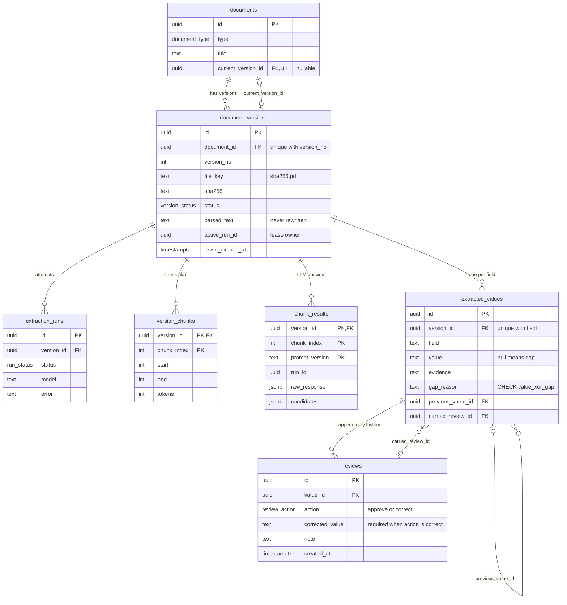

# Lomi Labs take-home: PDF extraction & review

This app pulls structured fields out of uploaded PDFs and shows each one to a person to check. A background worker sends the parsed text to Google Gemini (or a deterministic fake extractor). It keeps a value only when the value's quoted evidence appears in the text; otherwise it records a gap with a reason. A reviewer approves or corrects each value beside its quote. When a new version of a document is uploaded, a review carries over only if both the value and its quote are unchanged. Job state lives in Postgres, so extraction resumes after a worker restart, a Redis flush or a superseding upload.

**What has been verified, and how:** unit and Postgres integration tests ([Checks](#checks)); `scripts/verify-phase1.sh` and `scripts/chaos.sh` against the compose stack using the fake extractor (last run 2026-11-28, all checks passed, see [Verify](#verify)); and one live Gemini run on the three bundled fixtures (16/16 fields, 2026-11-27). **What has not:** the UI has no scripted tests (it was clicked through by hand), Gemini was tried on only three short documents, and there is no auth, OCR or deployment ([What I cut](#what-i-cut-and-whats-next)). Design: [`docs/superpowers/specs/2026-11-26-extraction-review-design.md`](docs/superpowers/specs/2026-11-26-extraction-review-design.md). Decisions: [`docs/decisions/`](docs/decisions/).

> The spec named Claude. The project owner removed it to avoid a paid API, so Gemini (free tier) is the only real provider.

## Run it

```sh
cp .env.example .env        # then set a key, see below
docker compose up --build
```

Pick the extractor in `.env` (compose passes these to the worker):

- **Gemini (the default, free tier):** set `GEMINI_API_KEY=...` (key from https://aistudio.google.com/apikey); `EXTRACTOR` can stay unset. Without a key every version fails visibly with `GEMINI_API_KEY is not set` and can be retried.
- **Fake (offline, no key):** `EXTRACTOR=fake`, optional `FAKE_EXTRACTOR_DELAY_MS=15000`. Deterministic values from the fixtures.

After changing `.env`, run `docker compose up -d worker` to recreate the worker.

**Low on memory?** Build one service at a time instead of one parallel build:

```sh
for s in migrate api worker web; do docker compose build $s; done
docker compose up -d
```

- Web UI: http://localhost:8080
- API: http://localhost:3000/health

Compose starts Postgres and Redis, runs migrations, seeds version 1 of each fixture, and then starts the api, worker, and web services.

**No Gemini key?** Run `EXTRACTOR=fake docker compose up --build` instead. The fake extractor returns deterministic values for the fixtures and needs no network.

### What to click first

1. Open http://localhost:8080. The three seeded documents go from Queued to Extracting to In review while the list polls.
2. Open the **invoice**. Each value sits beside its quote. Click a value to jump to its passage in the PDF; the Text tab highlights the quote. Approve a few values and correct one (with a note).
3. In the sidebar, **Upload new version** and pick `fixtures/documents/invoice-001.v2.pdf`. When it finishes, only `due_date` and `total_amount` are under Needs review, each showing its v1 value and review. The other three are Carried over.
4. Open the **market report**. `median_household_income` is a gap with its reason. Confirm it absent.

### Without Docker (local dev)

You need Postgres (16+; a native Windows Postgres 19 service works) and Redis 7 running locally, or point `DATABASE_URL` / `REDIS_URL` in `.env` at hosted ones. Any role that can create databases works (e.g. `postgresql://postgres:<password>@localhost:5432/lomi`); create the `lomi` database once with `CREATE DATABASE lomi`.

A native Postgres on port 5432 and the compose `postgres` service both want host port 5432: stop one before starting the other.

```sh
pnpm install
pnpm db:seed      # builds deps, runs migrations, then seeds
pnpm dev          # api :3000, worker, web :5173 (proxies /api -> :3000)
```

Relative `UPLOAD_DIR` and `FIXTURES_DIR` (the `./uploads` and `./fixtures` in `.env.example`) resolve against the repo root, not each app's folder, so the api, worker and seed share one `uploads/`. Absolute paths (compose uses `/data/uploads`) are used as given.

### Checks

```sh
pnpm -r run build && pnpm -r run typecheck && pnpm -r run lint && pnpm -r run test
pnpm --filter @lomi/db test:integration   # needs Postgres; uses TEST_DATABASE_URL
pnpm --filter @lomi/api test:integration  # needs Postgres; run after (not alongside) the db suite, they share lomi_test
pnpm --filter @lomi/worker test:integration # needs Postgres, no Redis, fake extractor only; run alone (shares lomi_test)
pnpm --filter @lomi/worker smoke:gemini   # check a Gemini key: lists models, one extraction on the invoice; needs GEMINI_API_KEY (free tier)
```

(`pnpm turbo …` does the same where Windows Application Control doesn't block the turbo binary.)

Unit tests (`*.test.ts`) need nothing running. Integration tests (`*.int.test.ts`) read `TEST_DATABASE_URL` from `.env`, create that database if it's missing, apply migrations, and truncate tables between tests; they never touch the dev database.

### Extractor settings (worker)

| Variable                  | Default                    | Effect                                                                                                                                                                        |
| ------------------------- | -------------------------- | ----------------------------------------------------------------------------------------------------------------------------------------------------------------------------- |
| `LLM_MAX_INFLIGHT`        | `4`                        | Max concurrent LLM calls (Gemini extractions).                                                                                                                                |
| `EXTRACTOR`               | `gemini`                   | `gemini` or `fake`. Any other value makes every version fail with a clear message.                                                                                            |
| `GEMINI_API_KEY`          | none                       | Required unless `EXTRACTOR=fake` (free tier: https://aistudio.google.com/apikey). Missing: the worker still starts, but every version fails with `GEMINI_API_KEY is not set`. |
| `GEMINI_MODEL`            | `gemini-3.6-flash`         | Primary Gemini model.                                                                                                                                                         |
| `GEMINI_FALLBACK_MODELS`  | `gemini-flash-lite-latest` | Comma-separated models tried in order when the primary is busy (429/503/timeout twice) or retired (404).                                                                      |
| `EXTRACTOR=fake`          | unset                      | Deterministic offline extractor for tests/e2e; ignores the API keys.                                                                                                          |
| `FAKE_EXTRACTOR_DELAY_MS` | `0`                        | Simulated latency per fake extraction.                                                                                                                                        |
| `CHUNK_CONCURRENCY`       | `3`                        | Chunks of one document extracted at once.                                                                                                                                     |

The Gemini extractor runs on Google's free tier, which has rate limits and models that are sometimes overloaded: a busy model is retried once, then the next fallback model is used, and stored results record which model answered. Token counts are a local estimate (length / 4), so Gemini uses no quota for them. Answers go through the same evidence check as the fake's.

## API

Errors are always `{ "error": "<code>", "message": "..." }`. The api only validates, writes to Postgres and enqueues a hint; it never parses PDFs or calls the LLM.

| Route                          | Success                                                                                                                                                    | Errors                                                                                                                                                             |
| ------------------------------ | ---------------------------------------------------------------------------------------------------------------------------------------------------------- | ------------------------------------------------------------------------------------------------------------------------------------------------------------------ |
| `POST /documents`              | `201` new document (v1 `queued`); `200` the existing one if the same file was uploaded                                                                     | `400` bad `type`, no file, or not a PDF; `413` over 20 MB                                                                                                          |
| `GET /documents/:id`           | `200` document, current version (or `?version=N`) and its values                                                                                           | `400` id not a UUID or bad `version`; `404` unknown document or version                                                                                            |
| `POST /documents/:id/retry`    | `202` failed version back to `queued`                                                                                                                      | `400` id not a UUID; `404` unknown document; `409` current version is not `failed`                                                                                 |
| `DELETE /documents/:id`        | `204` document and all its versions deleted                                                                                                                | `400` id not a UUID; `404` unknown document                                                                                                                        |
| `POST /documents/:id/versions` | `201` new version (`queued`, becomes current; unfinished older ones are superseded); `200` current summary if the file is identical to the current version | `400` id not a UUID, no file, or not a PDF; `404` unknown document; `413` over 20 MB                                                                               |
| `GET /documents/:id/versions`  | `200` every version, newest first, with its status                                                                                                         | `400` id not a UUID; `404` unknown document                                                                                                                        |
| `GET /values/:id/history`      | `200` the field's value in this and every earlier version, newest first, each with its reviews                                                             | `400` id not a UUID; `404` unknown value                                                                                                                           |
| `GET /documents`               | `200` every document, newest first, with its current version's status and review progress                                                                  | none                                                                                                                                                               |
| `GET /documents/:id/progress`  | `200` review counts (`pending`, `approved`, `corrected`, `carried_over`, `gaps`, `total`) of the current version                                           | `400` id not a UUID; `404` unknown document                                                                                                                        |
| `POST /values/:id/review`      | `201` review appended (`{ "action": "approve" }` or `{ "action": "correct", "value", "note"? }`); returns the value's new state and progress               | `400` id not a UUID, bad body, or a correction that is not valid for the field's type; `404` unknown value; `409` value is not of the current, `extracted` version |
| `GET /versions/:id/file`       | `200` the version's PDF, inline, cached as immutable                                                                                                       | `400` id not a UUID; `404` unknown version or file missing from the store                                                                                          |

```sh
curl -F type=invoice -F file=@fixtures/documents/invoice-001.pdf localhost:3000/documents
# {"id":"<uuid>","title":"invoice-001","type":"invoice","versionNo":1,"status":"queued"}
curl localhost:3000/documents/<uuid>
curl -X POST localhost:3000/documents/<uuid>/retry
```

## Review UI

Run `pnpm --filter @lomi/api dev` and `pnpm --filter @lomi/web dev`, then open http://localhost:5173. This is where the flow below was verified in a browser; the api starts and serves seeded PDFs with the stock relative paths from `.env.example`.

For the compose stack (http://localhost:8080), rebuild the images one service at a time first, so the new UI is served: `docker compose build api`, then `worker`, `web`, `migrate`, then `docker compose up -d`. On :8080, the pdf.js worker (`assets/pdf.worker.*.mjs`) is checked to come back as `application/javascript` and `/api/documents` to return JSON; the full flow has not been clicked through there in a browser.

The status pill is a UI-only review status derived on the client (the API's version statuses are fixed by the brief): Queued (grey), Extracting (yellow), Failed (red tint), In review (pink, extracted with values pending), Approved (green, nothing pending); older versions keep the raw status. Document types are colour-coded: invoice blue, lease teal, market report violet.

1. **List.** Every document with its status and review progress. Upload a PDF with the type picker; the list polls while anything is queued or processing and stops once all are extracted. A non-PDF shows `file is not a PDF`.
2. **Detail.** Click a document. Values are grouped into cards (Needs review, Carried over, Done), with "page N" beside the value when the PDF has more than one page (the quote is highlighted in the Text tab, not repeated on the card). The header shows progress. The page fits one screen: the version timeline (when there are several versions) stays on top, and the cards and the PDF/Text panel below share the same height, each scrolling on its own.
3. **Approve or correct.** Approve moves a card to Done. Correct opens an inline field; a value that does not fit the field type (`abc` for a money field) shows `"abc" is not a valid money`. A corrected card shows the new value with the original struck through. A gap offers "Confirm absent".
4. **Evidence.** Clicking a value jumps the PDF to its page without switching tabs; if the Text tab is open, it scrolls to the quote, highlighted in `<mark>`.
5. **Versions.** Once a document has more than one version, the detail page shows a horizontal version timeline on top (numbered dots joined by a line, oldest on the left, ten per page; the current version is filled, an older version being viewed is ringed, a failed one is rose; `?version=N` in the URL; the shown version's status and upload time are in the sidebar) and, in the sidebar on the current version, "Upload new version" (an identical file just refreshes). Older versions open read only, with a link back to the current one. A card whose previous version had a value shows a one-line label (for example `carried over from v1 (approved)` or `was $5,230.29 in v1 (not reviewed)`), the previous quote beside it, and, with more than one earlier version, a History drawer listing every version's value, quote and reviews.

6. **Delete.** Delete (from the documents table or the detail page) removes the document and all its versions after a confirmation that lists them; there is no per-version delete, since earlier versions must stay queryable. It works on any status, including while extracting (the worker stops at the next chunk). The seed re-adds deleted fixture documents on the next boot. Afterwards the deleted document's cached queries are dropped only once no mounted component reads them, so nothing refetches it into a 404.

The UI uses Mantine; the review model and that choice are in [0008](docs/decisions/0008-reviews.md).

Styling: a Mantine theme (`apps/web/src/theme.ts`) inspired by a pastel dashboard look: a cream page, a fixed warm-charcoal sidebar whose content is per page (the upload form on the list; on the detail page the document's summary: back link, delete, title and status pills, review-progress ring and versions, so the main panel starts at the review content) with API health at the bottom, pill statuses that always carry their text, and charcoal pill buttons. No extra font or icon dependency.

## Versions and carry-over

Code: `isUnchanged` (`packages/extraction/src/carry.ts`), `carryLinks` inside `finishVersion` (`packages/db/src/coordination.ts`), `createVersion` / `listVersions` (`packages/db/src/versions.ts`).

**What "unchanged" means.** "v1" is the latest `extracted` version older than the new one.

- "Same value" means equal after per-type normalization: money, numbers and percents compare by digits (`$5,230.29` = `5230.29`); dates compare by parsed date (`2025-09-14` = `September 14, 2025`); strings compare case-insensitively.
- "Quote found" means v1's quote appears anywhere in v2's text after both sides are normalized the same way: Unicode NFKC, curly quotes and dashes to ASCII, whitespace runs collapsed. Positions and pages are never compared, so a quote that moved to another line or page (the whole text shifted) still counts as found.

**What gets carried.**

| #   | Previous (v1)                                                                                             | New (v2)                                    | v2 state                                                     | Card label                                                                    |
| --- | --------------------------------------------------------------------------------------------------------- | ------------------------------------------- | ------------------------------------------------------------ | ----------------------------------------------------------------------------- |
| 1   | Value, approved                                                                                           | Same value, v1's quote found in v2's text   | `carried_over` (v1's approval)                               | carried over from v1 (approved)                                               |
| 2   | Value, corrected                                                                                          | Same value, quote found                     | `carried_over`; effective value = the correction             | carried over from v1 (corrected)                                              |
| 3   | Value carried over from an earlier version, no review of its own (e.g. v1 approved → v2 carried → now v3) | Same value, quote found                     | `carried_over` (the original review, passed along the chain) | carried over from v2 (approved)                                               |
| 4   | Value, never reviewed                                                                                     | Same value, quote found                     | `pending` (nothing to carry)                                 | unchanged from v1 (not reviewed there)                                        |
| 5   | Value (any review)                                                                                        | Different value                             | `pending`                                                    | was $5,230.29 in v1 (approved / corrected / not reviewed)                     |
| 6   | Value (any review)                                                                                        | Same value, v1's quote **not** in v2's text | `pending`                                                    | same value as v1 (approved / corrected / not reviewed), but its quote changed |
| 7   | Value (any review)                                                                                        | Gap                                         | `pending`                                                    | was $5,230.29 in v1 (approved / corrected / not reviewed)                     |
| 8   | Gap (any review)                                                                                          | Value                                       | `pending`                                                    | was a gap in v1 (confirmed absent / corrected / not reviewed)                 |
| 9   | Gap, confirmed absent                                                                                     | Gap                                         | `pending`: **gaps never carry**                              | also a gap in v1 (confirmed absent)                                           |
| 10  | Gap, corrected (value supplied)                                                                           | Gap                                         | `pending`                                                    | also a gap in v1, corrected to 52000                                          |
| 11  | Gap, never reviewed                                                                                       | Gap                                         | `pending`                                                    | also a gap in v1 (not reviewed)                                               |
| 12  | No extracted older version (v1 superseded or failed)                                                      | Anything                                    | `pending`, no previous link                                  | none                                                                          |

**Why.**

- A quote that still appears in the new text is the only evidence that the reviewed passage did not change. Comparing the old quote with the new text, not offsets, is what survives shifted text.
- Gaps never carry: a gap has no quote, so "still absent" cannot be verified, and the model may have missed a value that v2 now states.
- The baseline is the latest extracted older version, because superseded and failed versions have no values to compare.

Uploading a new version supersedes any older version that is still queued or extracting. Details in [0009](docs/decisions/0009-versions-and-carry-over.md).

## Worker

Postgres is the truth; BullMQ jobs are only hints (`{ versionId }`). A job runs `processVersion`:
claim (lease) -> parse the PDF once and store the text -> plan chunks -> extract each missing chunk
(3 at a time) -> merge -> finish. Finish also links each value to the previous version's value for the same field and carries that value's review when its evidence is unchanged. Every write is guarded by the run id, so a run that lost its lease
writes nothing. The lease is renewed on its own timer, so a slow LLM call cannot lose it.

| Event                           | What happens                                                                                                                          |
| ------------------------------- | ------------------------------------------------------------------------------------------------------------------------------------- |
| Worker killed / restart         | Lease expires (30 s); the reconciler (every 10 s) re-enqueues; the next run reuses stored text and chunk results.                     |
| SIGTERM                         | In-flight runs stop, the version goes back to `queued` without spending an attempt, and the next reconciler pass (≤ 10 s) resumes it. |
| Redis `FLUSHALL`                | Jobs vanish; the reconciler re-adds every `queued` or expired version from Postgres within 10 s.                                      |
| Missing key                     | Version `failed` with `GEMINI_API_KEY is not set`; `POST /documents/:id/retry` once it is set.                                        |
| Scanned PDF / too long          | Version `failed` with a clear message (`No text layer found...`, `Document too long (N chunks; limit 50)`).                           |
| Document deleted mid-extraction | The run's next ownership check (before each chunk) or lease renewal (≤ 10 s) fails; it writes nothing more and ends stale.            |

Env: `EXTRACTOR` (`gemini` default, `fake`), `GEMINI_API_KEY` / `GEMINI_MODEL`, `GEMINI_FALLBACK_MODELS`, `LLM_MAX_INFLIGHT`, `CHUNK_CONCURRENCY` (default 3), `UPLOAD_DIR`, `FIXTURES_DIR`, `REDIS_URL`, `DATABASE_URL`.

## Layout

```
apps/
  api/         Fastify HTTP API. Validates, writes to Postgres, enqueues jobs. Never calls the LLM.
  worker/      BullMQ worker. Parses the PDF, calls the configured LLM (Gemini or fake), validates evidence, writes values to Postgres.
  web/         Vite + React review UI (TanStack Query, React Router).
packages/
  db/          Prisma schema, SQL migrations (incl. hand-written CHECKs), seed script,
               document create/read/retry (documents.ts), worker claim/lease/finish (coordination.ts),
               test DB harness (@lomi/db/testing).
  files/       Content-addressed file store: files saved as <sha256>.pdf, written atomically.
  shared/      Zod schemas and types shared by API, worker, and UI (statuses, field defs).
  extraction/  Pure logic, no I/O: quote matching (text.ts), per-type value comparison (values.ts),
               page offsets (pages.ts), token-counted chunk planner (chunker.ts), prompt (prompt.ts),
               per-chunk validation (validate.ts), merge across chunks (merge.ts).
  queue/       BullMQ queue name, Redis connection, and job payload contract.
  config/      Shared tsconfig and ESLint flat config.
fixtures/      Sample PDFs and manifests from the assignment.
```

**Why these boundaries:**

- **api and worker are separate processes.** An upload never waits on the LLM, and each can crash or restart on its own.
- **`extraction` is pure.** The logic most likely to break (the hallucination check, carry-over matching) is unit-tested without Docker.
- **`db` and `queue` are shared.** The api, worker, and seed script agree on one schema and one job contract.

**Turbo pipeline:**

- `build`, `lint`, `typecheck`, and `test` all depend on `^build`, so a package's dependencies are built before it runs.
- `db:seed` depends on `db:migrate`.
- Outputs are cached. A second run with no changes is fully cached.

**Docker:** one `Dockerfile` uses `turbo prune` per app, so each image installs only its own dependency graph.

## Stack

| Concern      | Choice                   | Why                                                                                                                                                                                                                                                  |
| ------------ | ------------------------ | ---------------------------------------------------------------------------------------------------------------------------------------------------------------------------------------------------------------------------------------------------- |
| HTTP         | Fastify 5                | Built-in schema validation, `onClose` hooks for clean shutdown, pino logging, streaming multipart uploads                                                                                                                                            |
| DB           | Postgres 16 + Prisma 7   | Prisma 7 (`prisma-client` generator + `pg` driver adapter). Guarded `updateMany` + count checks, interactive transactions and `createMany({ skipDuplicates })` cover the idempotency rules; one raw `SELECT … FOR UPDATE` where row locks are needed |
| Queue        | BullMQ on Redis 7        | Coordinates work only. Postgres is the source of truth                                                                                                                                                                                               |
| LLM          | Gemini (default), fake   | JSON-schema structured outputs; the same evidence check applies to both ([0005](docs/decisions/0005-structured-outputs-and-model.md))                                                                                                                |
| PDF text     | unpdf                    | Maintained, pure JS                                                                                                                                                                                                                                  |
| UI           | Vite + React 19, Mantine | Plain SPA, no SSR needed. Mantine: the owner asked for a component library, it needs no Tailwind setup, and it supports React 19                                                                                                                     |
| Tests / lint | Vitest, ESLint, Prettier |                                                                                                                                                                                                                                                      |

## Verify

```sh
EXTRACTOR=fake FAKE_EXTRACTOR_DELAY_MS=15000 docker compose up -d   # build services one at a time first
bash scripts/verify-phase1.sh        # PASS/FAIL per check, non-zero exit on failure; restores the worker itself
bash scripts/chaos.sh                # the brief's failure scenarios, end state checked via the API only
```

`chaos.sh` runs, in order: (A) worker restart mid-extraction; (B) `FLUSHALL` plus restart of worker and api mid-extraction; (C) re-upload of B's file after the restart (200, same id, still one version); (D) v2 uploaded while v1 is extracting (v1 `superseded` with no values, v2 extracted with no previous links); (E) delete mid-extraction (404, and the next upload still extracts); (F) a sweep that every document is `extracted` with the expected value count and no field twice. Each check prints PASS or FAIL. Checks that depend on a break (for example "was extracting before the restart") fail if the break didn't happen, so nothing passes by accident.

Last run on 2026-11-28 against the compose images (fake extractor, 15 s delay): all 10 checks passed, `ALL CHECKS PASSED`.

The script needs bash (Git Bash on Windows), `curl`, `node` and `docker compose`, and the worker running with the fake extractor (it fails fast otherwise). It checks: the three seeded documents extract; a worker restart mid-extraction; a double upload (200, same id, one row); `FLUSHALL` plus restart of worker and api; `SIGKILL` of the worker (lease recovery); no duplicate values per version. When it ends (pass or fail) it restores the worker to your normal settings (`env -u EXTRACTOR -u FAKE_EXTRACTOR_DELAY_MS docker compose up -d worker`, i.e. from `.env` and compose defaults); a failure of that step does not change the exit code.

### Live extraction check

Run with Gemini (free tier) on 2026-11-27: the three fixtures were uploaded as new documents and extracted by `gemini-3.6-flash` (no fallback needed, one attempt each, 33 to 42 s per document). Result: **16 of 16 fields correct**, including the expected gap.

| Fixture       | Time   | Values                                                                                                                                                                                                                  |
| ------------- | ------ | ----------------------------------------------------------------------------------------------------------------------------------------------------------------------------------------------------------------------- |
| invoice       | 35.7 s | `invoice_number` INV-2025-0847, `issue_date` 2025-09-14, `due_date` 2025-10-14, `vendor_name` MERIDIAN OFFICE SUPPLIES LLC, `total_amount` $5,230.29                                                                    |
| lease         | 42.3 s | `tenant_name` Dana Okafor, `monthly_rent` $2,350.00, `security_deposit` $3,525.00, `lease_start` March 1, 2025, `term_months` 24                                                                                        |
| market report | 32.9 s | `report_quarter` Q3 2025, `market_area` Eastport-Harborview Submarket, `vacancy_rate` 4.2%, `average_rent_1br` $1,985, `year_over_year_rent_growth` 3.8%, `median_household_income` **gap** ("not stated in this part") |

`median_household_income` is a real gap: the report does not contain it, and the model returned no value instead of guessing.

History: an earlier run (before the numeric fix) was 15/16. The lease `term_months` came back as "twenty-four (24)" and failed the strict check. Since `e5dd89f` (prompt v2 and one-distinct-number rule, see [0007](docs/decisions/0007-numeric-values.md)) `term_months` is `24` and the run is 16/16. If every Gemini model is busy (429/503/timeouts) the versions go `failed` with a clear error and `POST /documents/:id/retry` re-runs only the missing chunks; no retry loop is built in beyond one retry per model.

## Schema

Full model in `packages/db/prisma/schema.prisma`. Key columns only below; lease, token and timestamp columns are left out.



- `documents` → has many `document_versions`. Each version stores its file key, sha256, **parsed text** (never rewritten), page offsets, status, and the lease fields the worker uses to claim it.
- `extraction_runs`: one per attempt (`running | succeeded | failed | abandoned`).
- `version_chunks` / `chunk_results`: the chunk plan and one stored LLM answer (prompt + raw response) per chunk, so a resumed run skips finished chunks.
- `extracted_values`: **unique (version_id, field)**, so a re-run can't duplicate values. A gap is `value = null` with a `gap_reason`, enforced by a CHECK constraint. `previous_value_id` / `carried_review_id` link to the previous version.
- `reviews`: append-only. The latest row per value is its current review.
- Delete is one PG transaction; PDFs are removed after commit, only when no other version uses them.

## Decisions

Short notes (context, decision, alternatives, consequences) in [`docs/decisions/`](docs/decisions/): Postgres as source of truth, lease and reconciler, strict evidence check, chunking, structured outputs and model choice, Prisma, numeric values, reviews ([0008](docs/decisions/0008-reviews.md)), versions and carry-over ([0009](docs/decisions/0009-versions-and-carry-over.md)).

## Open decisions the brief left

| Decision                         | Chose                                                                                         | Why                                                                                                                                                                                                                                                                                       |
| -------------------------------- | --------------------------------------------------------------------------------------------- | ----------------------------------------------------------------------------------------------------------------------------------------------------------------------------------------------------------------------------------------------------------------------------------------- |
| Correction model                 | Annotation: append-only `reviews` beside the extracted value                                  | The LLM's value and its quote stay intact for audit and for carry-over comparison. The effective value is the latest correction. The UI shows the correction with the original struck through ([0008](docs/decisions/0008-reviews.md)).                                                   |
| Parsed text                      | Stored per version, never rewritten                                                           | Evidence checks and the review UI for version N always use N's text, even after N+1 exists. Re-parsing could give different text if the parser changes.                                                                                                                                   |
| "Unchanged" evidence             | Same normalized value **and** the old quote still appears anywhere in the new text            | Position-free, so it survives text that shifts. See [Versions and carry-over](#versions-and-carry-over).                                                                                                                                                                                  |
| New version during an extraction | Supersede: the new version becomes current; the older unfinished one ends `superseded`        | The reviewer only cares about the latest file. Rejecting makes the client retry; queueing spends LLM calls on a version nobody will review. The old run notices at its next ownership check and writes nothing ([0009](docs/decisions/0009-versions-and-carry-over.md)).                  |
| UI updates                       | Polling every 2 s, **only while** a shown version is `queued` or `extracting`; otherwise none | Status changes a few times per document and extraction takes seconds to a minute, so a 2 s poll feels live. An idle page sends no requests. SSE or WebSockets would need a pub/sub path from worker to api and reconnect handling, for no visible gain here (`apps/web/src/lib/poll.ts`). |
| Identical re-upload              | `200` with the existing document or version (matched by sha256)                               | Covers the impatient double click without a second extraction.                                                                                                                                                                                                                            |
| Gaps across versions             | Never carry over                                                                              | "Still absent" can't be checked against a quote, and v2 may now state the value.                                                                                                                                                                                                          |

## What I cut, and what's next

Cut for time:

- **Draft → submit review flow.** Each approve or correct click saves at once. Next: hold drafts per version, add a sticky submit bar with a before/after summary, and save everything at once with `POST /documents/:id/reviews`.
- **Auth and reviewer identity.** Reviews have no author. Next: users, and `reviewer_id` on `reviews`.
- **Other LLM providers.** Only Gemini (free tier) plus the fake. Another provider is one `Extractor` class plus a factory branch.
- **OCR.** A scanned PDF with no text layer fails with a clear message instead of being OCR'd.
- **Deployment.** No live link. The stack runs locally only.
- **Browser e2e tests.** The UI was clicked through by hand. The API, worker and chaos scenarios are scripted, but nothing scripted drives the UI.

## At 10,000 documents

- **List and progress queries.** `GET /documents` returns everything and computes progress per request. Add pagination and filters, and keep per-version review counters (updated in the review transaction) so the list doesn't aggregate values.
- **Reconciler.** It scans for `queued` and expired-lease versions every 10 s (indexed on `(status, lease_expires_at)`). Every worker replica runs one today, which is safe (the BullMQ job id is the version id plus its attempt, so duplicate enqueues collapse, and the lease lets only one run own a version) but redundant. Next: one leader via a Postgres advisory lock, and batched scans.
- **LLM throughput.** Workers scale horizontally on the queue, but provider rate limits become the bottleneck. Add a global rate limiter in Redis, per-tenant fairness, backoff with jitter on 429s, and a paid tier or several providers.
- **Text storage.** Parsed text and raw LLM responses live in Postgres rows. Move large blobs to object storage (S3) with keys in Postgres, and keep only what the UI and evidence checks need.
- **Files.** The local `uploads` volume becomes S3. The content-addressed keys already suit that.
- **UI.** Polling a long list gets expensive. Poll only the in-flight IDs, or switch to SSE fed by Postgres `LISTEN/NOTIFY` once many reviewers watch at once.
- **Long documents.** The 50-chunk limit fails a long document today. Next: retrieval to find the passages for each field, instead of sending every chunk.
