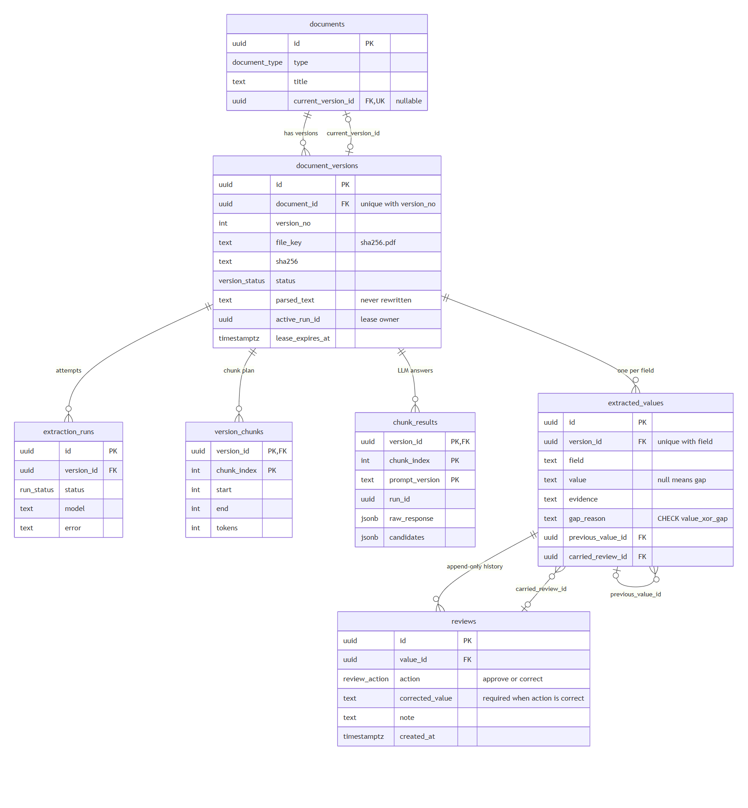

# Lomi Labs take-home: PDF extraction & review

This app pulls structured fields out of uploaded PDFs and shows each one to a person to check. A background worker sends the parsed text to Google Gemini (or a deterministic fake extractor). It keeps a value only when the value's quoted evidence appears in the text; otherwise it records a gap with a reason. A reviewer approves or corrects each value beside its quote. When a new version of a document is uploaded, a review carries over only if both the value and its quote are unchanged. Job state lives in Postgres, so extraction resumes after a worker restart, a Redis flush or a superseding upload.

Results: [Verify](#verify). Design spec: [`docs/superpowers/specs/2026-11-26-extraction-review-design.md`](docs/superpowers/specs/2026-11-26-extraction-review-design.md).

## Run it

```sh
cp .env.example .env        # set GEMINI_API_KEY (free: https://aistudio.google.com/apikey), or EXTRACTOR=fake for offline
docker compose up --build   # low on memory: for s in migrate api worker web; do docker compose build $s; done
```

Compose starts Postgres and Redis, runs migrations, seeds version 1 of each fixture, then starts the api (http://localhost:3000/health), worker and web (http://localhost:8080). Without a key every version fails visibly with `GEMINI_API_KEY is not set` and can be retried. After changing `.env`, run `docker compose up -d worker`; after code changes, rebuild the images.

### What to click first

1. Open http://localhost:8080. The three seeded documents go from Queued to Extracting to In review while the list polls. (In review and Approved are derived by the UI from the API's version status and the pending count.)
2. Open the **invoice**. Each value sits beside its quote. Click a value to jump to its passage in the PDF; the Text tab highlights the quote. Approve a few values and correct one (with a note).
3. In the sidebar, **Upload new version** and pick `fixtures/documents/invoice-001.v2.pdf`. When it finishes, only `due_date` and `total_amount` are under Needs review, each showing its v1 value and review. The other three are Carried over.
4. Open the **market report**. `median_household_income` is a gap with its reason. Confirm it absent.

### Without Docker (local dev)

You need Postgres (16+; a native Windows Postgres 19 service works) and Redis 7 running locally, or point `DATABASE_URL` / `REDIS_URL` in `.env` at hosted ones. Any role that can create databases works (e.g. `postgresql://postgres:<password>@localhost:5432/lomi`); create the `lomi` database once with `CREATE DATABASE lomi`.

A native Postgres on port 5432 and the compose `postgres` service both want host port 5432: stop one before starting the other.

```sh
pnpm install
pnpm db:seed      # builds deps, runs migrations, then seeds
pnpm dev          # api :3000, worker, web :5173 (proxies /api -> :3000)
```

Relative `UPLOAD_DIR` and `FIXTURES_DIR` (the `./uploads` and `./fixtures` in `.env.example`) resolve against the repo root, not each app's folder, so the api, worker and seed share one `uploads/`. Absolute paths (compose uses `/data/uploads`) are used as given.

### Extractor settings (worker)

| Variable                  | Default                    | Effect                                                                                                                                                                        |
| ------------------------- | -------------------------- | ----------------------------------------------------------------------------------------------------------------------------------------------------------------------------- |
| `LLM_MAX_INFLIGHT`        | `4`                        | Max concurrent LLM calls (Gemini extractions).                                                                                                                                |
| `EXTRACTOR`               | `gemini`                   | `gemini` or `fake`. Any other value makes every version fail with a clear message.                                                                                            |
| `GEMINI_API_KEY`          | none                       | Required unless `EXTRACTOR=fake` (free tier: https://aistudio.google.com/apikey). Missing: the worker still starts, but every version fails with `GEMINI_API_KEY is not set`. |
| `GEMINI_MODEL`            | `gemini-3.6-flash`         | Primary Gemini model.                                                                                                                                                         |
| `GEMINI_FALLBACK_MODELS`  | `gemini-flash-lite-latest` | Comma-separated models tried in order when the primary is busy (429/503/timeout twice) or retired (404).                                                                      |
| `FAKE_EXTRACTOR_DELAY_MS` | `0`                        | Simulated latency per fake extraction.                                                                                                                                        |
| `CHUNK_CONCURRENCY`       | `3`                        | Chunks of one document extracted at once.                                                                                                                                     |

Stored results record which model answered. Token counts are a local estimate (length / 4), so they use no Gemini quota.

## API

Errors are always `{ "error": "<code>", "message": "..." }`.

| Route                          | Success                                                                                                                                                    | Errors                                                                                                                                                             |
| ------------------------------ | ---------------------------------------------------------------------------------------------------------------------------------------------------------- | ------------------------------------------------------------------------------------------------------------------------------------------------------------------ |
| `POST /documents`              | `201` new document (v1 `queued`); `200` the existing one if the same file was uploaded                                                                     | `400` bad `type`, no file, or not a PDF; `413` over 20 MB                                                                                                          |
| `GET /documents/:id`           | `200` document, current version (or `?version=N`) and its values                                                                                           | `400` id not a UUID or bad `version`; `404` unknown document or version                                                                                            |
| `POST /documents/:id/retry`    | `202` failed version back to `queued`                                                                                                                      | `400` id not a UUID; `404` unknown document; `409` current version is not `failed`                                                                                 |
| `DELETE /documents/:id`        | `204` document and all its versions deleted                                                                                                                | `400` id not a UUID; `404` unknown document                                                                                                                        |
| `POST /documents/:id/versions` | `201` new version (`queued`, becomes current; unfinished older ones are superseded); `200` current summary if the file is identical to the current version | `400` id not a UUID, no file, or not a PDF; `404` unknown document; `413` over 20 MB                                                                               |
| `GET /documents/:id/versions`  | `200` every version, newest first, with its status                                                                                                         | `400` id not a UUID; `404` unknown document                                                                                                                        |
| `GET /values/:id/history`      | `200` the field's value in this and every earlier version, newest first, each with its reviews                                                             | `400` id not a UUID; `404` unknown value                                                                                                                           |
| `GET /documents`               | `200` every document, newest first, with its current version's status and review progress                                                                  | none                                                                                                                                                               |
| `GET /documents/:id/progress`  | `200` review counts (`pending`, `approved`, `corrected`, `carried_over`, `gaps`, `total`) of the current version                                           | `400` id not a UUID; `404` unknown document                                                                                                                        |
| `POST /values/:id/review`      | `201` review appended (`{ "action": "approve" }` or `{ "action": "correct", "value", "note"? }`); returns the value's new state and progress               | `400` id not a UUID, bad body, or a correction that is not valid for the field's type; `404` unknown value; `409` value is not of the current, `extracted` version |
| `GET /versions/:id/file`       | `200` the version's PDF, inline, cached as immutable                                                                                                       | `400` id not a UUID; `404` unknown version or file missing from the store                                                                                          |

```sh
curl -F type=invoice -F file=@fixtures/documents/invoice-001.pdf localhost:3000/documents
# {"id":"<uuid>","title":"invoice-001","type":"invoice","versionNo":1,"status":"queued"}
curl localhost:3000/documents/<uuid>
curl -X POST localhost:3000/documents/<uuid>/retry
```

## Versions and carry-over

Code: `isUnchanged` (`packages/extraction/src/carry.ts`), `carryLinks` inside `finishVersion` (`packages/db/src/coordination.ts`), `createVersion` / `listVersions` (`packages/db/src/versions.ts`).

**What "unchanged" means.** "v1" is the latest `extracted` version older than the new one.

- "Same value" means equal after per-type normalization: money, numbers and percents compare by digits (`$5,230.29` = `5230.29`); dates compare by parsed date (`2025-09-14` = `September 14, 2025`); strings compare case-insensitively.
- "Quote found" means v1's quote appears anywhere in v2's text after both sides are normalized the same way: Unicode NFKC, curly quotes and dashes to ASCII, whitespace runs collapsed. Positions and pages are never compared, so a quote that moved to another line or page (the whole text shifted) still counts as found.

**What gets carried.**

| #   | Previous (v1)                                                                                             | New (v2)                                    | v2 state                                                     | Card label                                                                    |
| --- | --------------------------------------------------------------------------------------------------------- | ------------------------------------------- | ------------------------------------------------------------ | ----------------------------------------------------------------------------- |
| 1   | Value, approved                                                                                           | Same value, v1's quote found in v2's text   | `carried_over` (v1's approval)                               | carried over from v1 (approved)                                               |
| 2   | Value, corrected                                                                                          | Same value, quote found                     | `carried_over`; effective value = the correction             | carried over from v1 (corrected)                                              |
| 3   | Value carried over from an earlier version, no review of its own (e.g. v1 approved → v2 carried → now v3) | Same value, quote found                     | `carried_over` (the original review, passed along the chain) | carried over from v2 (approved)                                               |
| 4   | Value, never reviewed                                                                                     | Same value, quote found                     | `pending` (nothing to carry)                                 | unchanged from v1 (not reviewed there)                                        |
| 5   | Value (any review)                                                                                        | Different value                             | `pending`                                                    | was $5,230.29 in v1 (approved / corrected / not reviewed)                     |
| 6   | Value (any review)                                                                                        | Same value, v1's quote **not** in v2's text | `pending`                                                    | same value as v1 (approved / corrected / not reviewed), but its quote changed |
| 7   | Value (any review)                                                                                        | Gap                                         | `pending`                                                    | was $5,230.29 in v1 (approved / corrected / not reviewed)                     |
| 8   | Gap (any review)                                                                                          | Value                                       | `pending`                                                    | was a gap in v1 (confirmed absent / corrected / not reviewed)                 |
| 9   | Gap, confirmed absent                                                                                     | Gap                                         | `pending`: **gaps never carry**                              | also a gap in v1 (confirmed absent)                                           |
| 10  | Gap, corrected (value supplied)                                                                           | Gap                                         | `pending`                                                    | also a gap in v1, corrected to 52000                                          |
| 11  | Gap, never reviewed                                                                                       | Gap                                         | `pending`                                                    | also a gap in v1 (not reviewed)                                               |
| 12  | No extracted older version (v1 superseded or failed)                                                      | Anything                                    | `pending`, no previous link                                  | none                                                                          |

**Why.**

- A quote that still appears in the new text is the only evidence that the reviewed passage did not change. Comparing the old quote with the new text, not offsets, is what survives shifted text.
- Gaps never carry: a gap has no quote, so "still absent" cannot be verified, and the model may have missed a value that v2 now states.
- The baseline is the latest extracted older version, because superseded and failed versions have no values to compare.

## Worker

Postgres is the truth; BullMQ jobs are only hints (`{ versionId }`). A job runs `processVersion`:
claim (lease) -> parse the PDF once and store the text -> plan chunks -> extract each missing chunk
(3 at a time) -> merge -> finish. Finish also links each value to the previous version's value for the same field and carries that value's review when its evidence is unchanged. Every write is guarded by the run id, so a run that lost its lease
writes nothing. The lease is renewed on its own timer, so a slow LLM call cannot lose it. A reconciler re-enqueues every `queued` or expired-lease version from Postgres every 10 s, so lost jobs (crash, `FLUSHALL`) and failed enqueues repair themselves. How each failure ends: [Critical scenarios](#critical-scenarios).

## Layout

```
apps/
  api/         Fastify HTTP API. Validates, writes to Postgres, enqueues jobs. Never calls the LLM.
  worker/      BullMQ worker. Parses the PDF, calls the configured LLM (Gemini or fake), validates evidence, writes values to Postgres.
  web/         Vite + React review UI (TanStack Query, React Router).
packages/
  db/          Prisma schema, SQL migrations (incl. hand-written CHECKs), seed script,
               document create/read/retry (documents.ts), worker claim/lease/finish (coordination.ts),
               test DB harness (@lomi/db/testing).
  files/       Content-addressed file store: files saved as <sha256>.pdf, written atomically.
  shared/      Zod schemas and types shared by API, worker, and UI (statuses, field defs).
  extraction/  Pure logic, no I/O: quote matching (text.ts), per-type value comparison (values.ts),
               page offsets (pages.ts), token-counted chunk planner (chunker.ts), prompt (prompt.ts),
               per-chunk validation (validate.ts), merge across chunks (merge.ts).
  queue/       BullMQ queue name, Redis connection, and job payload contract.
  config/      Shared tsconfig and ESLint flat config.
fixtures/      Sample PDFs and manifests from the assignment.
```

**Why these boundaries:**

- **api and worker are separate processes.** An upload never waits on the LLM, and each can crash or restart on its own.
- **`extraction` is pure.** The logic most likely to break (the hallucination check, carry-over matching) is unit-tested without Docker.
- **`db` and `queue` are shared.** The api, worker, and seed script agree on one schema and one job contract.

**Turbo pipeline:**

- `build`, `lint`, `typecheck`, and `test` all depend on `^build`, so a package's dependencies are built before it runs.
- `db:seed` depends on `db:migrate`.
- Outputs are cached. A second run with no changes is fully cached.

**Docker:** one `Dockerfile` uses `turbo prune` per app, so each image installs only its own dependency graph.

## Stack

| Concern      | Choice                   | Why                                                                                                                                                                                                                                                  |
| ------------ | ------------------------ | ---------------------------------------------------------------------------------------------------------------------------------------------------------------------------------------------------------------------------------------------------- |
| HTTP         | Fastify 5                | Built-in schema validation, `onClose` hooks for clean shutdown, pino logging, streaming multipart uploads                                                                                                                                            |
| DB           | Postgres 16 + Prisma 7   | Prisma 7 (`prisma-client` generator + `pg` driver adapter). Guarded `updateMany` + count checks, interactive transactions and `createMany({ skipDuplicates })` cover the idempotency rules; one raw `SELECT … FOR UPDATE` where row locks are needed |
| Queue        | BullMQ on Redis 7        | Coordinates work only. Postgres is the source of truth                                                                                                                                                                                               |
| LLM          | Gemini (default), fake   | JSON-schema structured outputs; the same evidence check applies to both ([0005](docs/decisions/0005-structured-outputs-and-model.md))                                                                                                                |
| PDF text     | unpdf                    | Maintained, pure JS                                                                                                                                                                                                                                  |
| UI           | Vite + React 19, Mantine | Plain SPA, no SSR needed. Mantine: the owner asked for a component library, it needs no Tailwind setup, and it supports React 19                                                                                                                     |
| Tests / lint | Vitest, ESLint, Prettier |                                                                                                                                                                                                                                                      |

## Verify

### Tests

```sh
pnpm build && pnpm typecheck && pnpm lint && pnpm test   # turbo pipeline; unit tests of every package, web included
pnpm --filter @lomi/web test                # web only: apps/web/src/lib logic (no component or browser tests)
pnpm --filter @lomi/db test:integration     # needs Postgres (TEST_DATABASE_URL)
pnpm --filter @lomi/api test:integration    # needs Postgres; run after the db suite (they share lomi_test)
pnpm --filter @lomi/worker test:integration # needs Postgres, fake extractor only; run alone
pnpm --filter @lomi/worker smoke:gemini     # checks a Gemini key: lists models, extracts the invoice once
```

Unit tests need nothing running. Integration tests create and migrate `TEST_DATABASE_URL` themselves and never touch the dev database. Where Windows Application Control blocks the turbo binary, use `pnpm -r run <task>`.

### Scripts

```sh
EXTRACTOR=fake FAKE_EXTRACTOR_DELAY_MS=15000 docker compose up -d   # build services one at a time first
bash scripts/verify-phase1.sh   # seeded docs, restart, double upload, FLUSHALL, SIGKILL, no duplicate values
bash scripts/chaos.sh           # restart, FLUSHALL, re-upload, v2 during v1, delete mid-extraction, sweep (API only)
```

Both need bash (Git Bash on Windows), `curl`, `node`, `docker compose` and the worker on the fake extractor (they fail fast otherwise). Each prints PASS/FAIL per check, exits non-zero on any failure and restores the worker to `.env` settings on exit. A check whose break didn't land (e.g. the document was already extracted) fails, so nothing passes by accident.

### Critical scenarios

Last run 2026-11-28: unit 210/210, integration 154/154 (db 85, api 49, worker 20), `verify-phase1.sh` 9/9, `chaos.sh` 10/10. Each scenario below is covered by those tests and scripts. The UI has no scripted tests (see [What I cut](#what-i-cut-and-whats-next)).

| Scenario                             | Expected behavior                                                                                                              |
| ------------------------------------ | ------------------------------------------------------------------------------------------------------------------------------ |
| Worker crash mid-extraction          | Lease (30 s) expires, reconciler re-enqueues, a new run finishes; the dead run can't write; 3 interruptions → `failed`         |
| Worker restart (SIGTERM)             | The run hands the version back to `queued` without spending an attempt; the next reconciler pass resumes it                    |
| Missing key, scanned or too-long PDF | `failed` with a clear message (`GEMINI_API_KEY is not set`, `No text layer found…`, `Document too long…`); retryable           |
| Redis `FLUSHALL`                     | Postgres is the truth; reconciler (≤ 10 s) re-enqueues and extraction completes                                                |
| Duplicate upload                     | 200, same id, one version, no second enqueue                                                                                   |
| Duplicate extraction job             | One run claims, the other is `skipped`; a stale run can't write                                                                |
| LLM failure and retry                | 429/503/timeout: one retry, then fallback model, then `failed`; `POST /retry` re-runs only missing chunks; no automatic re-run |
| v2 while v1 is extracting            | v2 current; v1 `superseded` with no values; v2 has no previous links                                                           |
| Changed evidence                     | `pending`, linked to the previous value, review not carried                                                                    |
| Unchanged evidence                   | `carried_over`, including corrections and v1 → v2 → v3 chains                                                                  |
| Missing fields                       | `value = null` with a gap reason, also for conflicting or hallucinated values                                                  |
| Delete mid-extraction                | 204, then 404; the run stops, writes nothing and frees its slot                                                                |

### Live extraction check

Gemini free tier, `gemini-3.6-flash`, the three fixtures uploaded fresh; one attempt each, no fallback. **16/16 correct on 2026-11-27 and again on 2026-11-28.**

| Fixture       | Time (11-27 / 11-28) | Values                                                                                                                                                                                                                                  |
| ------------- | -------------------- | --------------------------------------------------------------------------------------------------------------------------------------------------------------------------------------------------------------------------------------- |
| invoice       | 36 s / 35 s          | `invoice_number` INV-2025-0847, `issue_date` 2025-09-14, `due_date` 2025-10-14, `vendor_name` MERIDIAN OFFICE SUPPLIES LLC, `total_amount` $5,230.29                                                                                    |
| lease         | 42 s / 37 s          | `tenant_name` Dana Okafor, `monthly_rent` $2,350.00, `security_deposit` $3,525.00, `lease_start` March 1, 2025, `term_months` 24                                                                                                        |
| market report | 33 s / 120 s         | `report_quarter` Q3 2025, `market_area` Eastport-Harborview Submarket, `vacancy_rate` 4.2%, `average_rent_1br` $1,985, `year_over_year_rent_growth` 3.8%, `median_household_income` **gap** (not in the report; the model didn't guess) |

## Schema

Full model in `packages/db/prisma/schema.prisma`. Key columns only below; lease, token and timestamp columns are left out.



Source: [`docs/schema-er.mmd`](docs/schema-er.mmd) (GitHub can't render it inline, so the PNG is rendered with Mermaid 11).

- `documents` → has many `document_versions`. Each version stores its file key, sha256, **parsed text** (never rewritten), page offsets, status, and the lease fields the worker uses to claim it.
- `extraction_runs`: one per attempt (`running | succeeded | failed | abandoned`).
- `version_chunks` / `chunk_results`: the chunk plan and one stored LLM answer (prompt + raw response) per chunk, so a resumed run skips finished chunks.
- `extracted_values`: **unique (version_id, field)**, so a re-run can't duplicate values. A gap is `value = null` with a `gap_reason`, enforced by a CHECK constraint. `previous_value_id` / `carried_review_id` link to the previous version.
- `reviews`: append-only. The latest row per value is its current review.
- Delete is one PG transaction; PDFs are removed after commit, only when no other version uses them.

## Decisions

Short notes (context, decision, alternatives, consequences) in [`docs/decisions/`](docs/decisions/): Postgres as source of truth, lease and reconciler, strict evidence check, chunking, structured outputs and model choice, Prisma, numeric values, reviews ([0008](docs/decisions/0008-reviews.md)), versions and carry-over ([0009](docs/decisions/0009-versions-and-carry-over.md)), document delete ([0010](docs/decisions/0010-document-delete.md)).

## Open decisions the brief left

| Decision                         | Chose                                                                                         | Why                                                                                                                                                                                                                                                                                       |
| -------------------------------- | --------------------------------------------------------------------------------------------- | ----------------------------------------------------------------------------------------------------------------------------------------------------------------------------------------------------------------------------------------------------------------------------------------- |
| Correction model                 | Annotation: append-only `reviews` beside the extracted value                                  | The LLM's value and its quote stay intact for audit and for carry-over comparison. The effective value is the latest correction. The UI shows the correction with the original struck through ([0008](docs/decisions/0008-reviews.md)).                                                   |
| Parsed text                      | Stored per version, never rewritten                                                           | Evidence checks and the review UI for version N always use N's text, even after N+1 exists. Re-parsing could give different text if the parser changes.                                                                                                                                   |
| "Unchanged" evidence             | Same normalized value **and** the old quote still appears anywhere in the new text            | Position-free, so it survives text that shifts. See [Versions and carry-over](#versions-and-carry-over).                                                                                                                                                                                  |
| New version during an extraction | Supersede: the new version becomes current; the older unfinished one ends `superseded`        | The reviewer only cares about the latest file. Rejecting makes the client retry; queueing spends LLM calls on a version nobody will review. The old run notices at its next ownership check and writes nothing ([0009](docs/decisions/0009-versions-and-carry-over.md)).                  |
| UI updates                       | Polling every 2 s, **only while** a shown version is `queued` or `extracting`; otherwise none | Status changes a few times per document and extraction takes seconds to a minute, so a 2 s poll feels live. An idle page sends no requests. SSE or WebSockets would need a pub/sub path from worker to api and reconnect handling, for no visible gain here (`apps/web/src/lib/poll.ts`). |
| Identical re-upload              | `200` with the existing document or version (matched by sha256)                               | Covers the impatient double click without a second extraction.                                                                                                                                                                                                                            |

## What I cut, and what's next

Cut for time:

- **Draft → submit review flow.** Each approve or correct click saves at once. Next: hold drafts per version, add a sticky submit bar with a before/after summary, and save everything at once with `POST /documents/:id/reviews`.
- **Auth and reviewer identity.** Reviews have no author. Next: users, and `reviewer_id` on `reviews`.
- **Other LLM providers.** Only Gemini (free tier) plus the fake. Another provider is one `Extractor` class plus a factory branch.
- **OCR.** A scanned PDF with no text layer fails with a clear message instead of being OCR'd.
- **Deployment.** No live link. The stack runs locally only.
- **Browser e2e tests.** The UI was clicked through by hand on the dev server (:5173); on the compose stack (:8080) only the asset and API responses were checked. The API, worker and chaos scenarios are scripted, but nothing scripted drives the UI.

## At 10,000 documents

- **List and progress queries.** `GET /documents` returns everything and computes progress per request. Add pagination and filters, and keep per-version review counters (updated in the review transaction) so the list doesn't aggregate values.
- **Reconciler.** It scans for `queued` and expired-lease versions every 10 s (indexed on `(status, lease_expires_at)`). Every worker replica runs one today, which is safe (the BullMQ job id is the version id plus its attempt, so duplicate enqueues collapse, and the lease lets only one run own a version) but redundant. Next: one leader via a Postgres advisory lock, and batched scans.
- **LLM throughput.** Workers scale horizontally on the queue, but provider rate limits become the bottleneck. Add a global rate limiter in Redis, per-tenant fairness, backoff with jitter on 429s, and a paid tier or several providers.
- **Text storage.** Parsed text and raw LLM responses live in Postgres rows. Move large blobs to object storage (S3) with keys in Postgres, and keep only what the UI and evidence checks need.
- **Files.** The local `uploads` volume becomes S3. The content-addressed keys already suit that.
- **UI.** Polling a long list gets expensive. Poll only the in-flight IDs, or switch to SSE fed by Postgres `LISTEN/NOTIFY` once many reviewers watch at once.
- **Long documents.** The 50-chunk limit fails a long document today. Next: retrieval to find the passages for each field, instead of sending every chunk.
